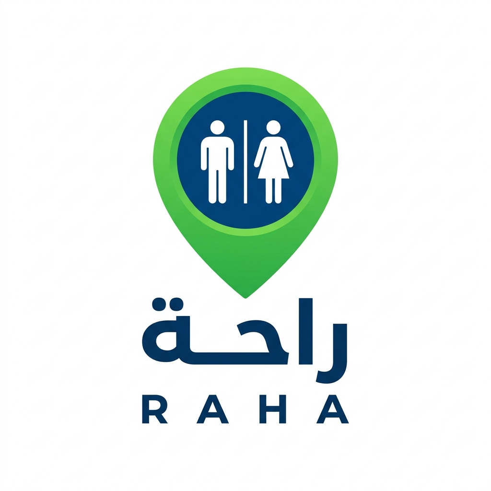

# 🇩🇿 تطبيق راحة | RAHA - DZ Restrooms & Ablution Guide

<p align="center">
  
</p>

<p align="center">
  <strong>دليلك الذكي ومجتمعك التشاركي لدورات المياه العمومية والحمامات ومرافق الوضوء في الجزائر</strong><br>
  <em>Smart Guide & Community for Public Restrooms, Hammams & Mosque Ablution Facilities across the 58 Algerian Wilayas</em>
</p>

<p align="center">
  
  
  
  
  
  
</p>

---

## 📖 جدول المحتويات / Table of Contents
- [نبذة عن المشروع (About)](#-نبذة-عن-المشروع--about)
- [المميزات الرئيسية (Key Features)](#-المميزات-الرئيسية--key-features)
- [المعمارية والتقنيات (Architecture & Stack)](#-المعمارية-والتقنيات--architecture--stack)
- [هيكلية المشروع (Project Structure)](#-هيكلية-المشروع--project-structure)
- [شاشات وأقسام التطبيق (App Screens)](#-شاشات-وأقسام-التطبيق--app-screens)
- [التشغيل والبناء (Getting Started)](#-التشغيل-والبناء--getting-started)
- [المساهمة والدعم (Donations & Contributions)](#-المساهمة-والدعم--donations--contributions)
- [الترخيص (License)](#-الترخيص--license)

---

## 🌟 نبذة عن المشروع / About

يعاني الكثير من المواطنين والمسافرين والسياح في الجزائر من صعوبة العثور على دورات مياه نظيفة أو مرافق وضوء وحمامات مناسبة أثناء تنقلهم في الطرقات السريعة، محطات النقل، والمراكز الحضرية.

**تطبيق راحة (RAHA)** هو حل رقمي متكامل ومبني محلياً بنمط **Offline-First**، يتيح للمستخدمين:
1. العثور الفوري على أقرب نقطة راحة ودورة مياه عمومية أو مسجد أو حمام أو محطة خدمات.
2. تصفية النتائج بناءً على معايير الجودة والنظافة، توفر الصابون والماء، والتوافق مع ذوي الهمم (PMR) والأمهات والأطفال.
3. العمل بكفاءة تامة **بدون إنترنت (100% Offline)** اعتماداً على قاعدة بيانات محلية مدمجة.
4. دعم المبادرات الخيرية لصيانة ونظافة دورات مياه المساجد عبر التبرعات التشاركية (صدقة جارية).

---

## 🚀 المميزات الرئيسية / Key Features

### 1. 🗺️ خريطة ذكية وبحث شامل بالولايات الـ 58
* خريطة تفاعلية مدعومة بـ **Google Maps SDK** مع شريط بحث عائم أعلى الشاشة للبحث المباشر بجميع ولايات الجزائر والبلديات والأحياء.
* **محرك خرائط بديل دون اتصال (Offline Vector Map):** رسم متجهي سلس مبني داخل الـ Compose Canvas يضمن عمل الخريطة حتى في حال عدم توفر اتصال بالإنترنت أو عدم توفر مفتاح Google Maps API.
* زر مخصص لتحديد الموقع الحالي بواسطة **GPS** وعرض مؤشر توجيه دقيق.

### 2. ⚡ بطاقة أقرب دورة مياه للطوارئ (Emergency Nearest Restroom)
* حساب المسافة المباشرة بين موقع المستخدم وجميع المرافق وعرض بطاقة فورية لأقرب مرفق مع زر انطلاق للتوجيه الملاحي عبر خرائط Google.

### 3. 🔍 فلاتر متقدمة وتصنيفات تفصيلية
* **تصنيفات المرافق:**
  * 🕌 **مساجد ومرافق وضوء** (مجانية مع فحص توفر المياه).
  * 🚿 **حمامات شعبية ودوش ساخن** (عرض التكلفة ومواعيد العمل).
  * ⛽ **محطات خدمات ونقاط استراحة** (طريق سيار شرق-غرب والوطني).
  * 🏬 **مراكز تجارية ومحطات نقل**.
* **فلاتر الخصائص والشمولية:**
  * 🧕 مخصص للنساء (قسم منفصل وآمن).
  * ♿ مهيأ لذوي الهمم (PMR - Ramp / كراسي مخصصة).
  * 👶 طاولة تغيير حفاضات الرضع للأمهات والعائلات.
  * ✨ نظافة عالية (تقييم 4 نجوم فما فوق).
  * 💧 الإبلاغ عن انقطاع المياه في الوقت الفعلي.

### 4. 📴 عمل كامل بدون إنترنت (Offline-First via Room Database)
* قاعدة بيانات محلية **Android Room** مجهزة مسبقاً بمئات المرافق ونقاط الاستراحة الموثقة عبر القطر الوطني.
* تخزين واسترجاع الموقع الجغرافي الأخير وإمكانية تحديث المزامنة مع خوادم السحاب عند عودة الاتصال.

### 5. 🕌 مبادرة التبرعات وصيانة دورات مياه المساجد (صدقة جارية)
* **دعم منصة راحة:** مساهمة المستخدمين في مصاريف الخوادم والخرائط عبر **BaridiMob RIP** و **الحساب البريدي الجاري CCP**.
* **مشاريع صيانة ميضآت المساجد:** بطاقات لمشاريع الجمعيات الدينية في مختلف الولايات (الجزائر، وهران، قسنطينة، سطيف، تيزي وزو، غرداية) مع أشرطة تقدم ونسب التبرع ونسخ أرقام الـ RIP وCCP بنقرة واحدة.

### 6. 🎨 تخصيص الهوية و 5 ثيمات جزائرية (Personalization)
* **5 ثيمات ألوان أصلية مستوحاة من البيئة الجزائرية:**
  1. *زمرد راحة (الأصلي)* 🟢
  2. *رمال الصحراء الذهبية* 🟡
  3. *أزرق البحر الأبيض المتوسط* 🔵
  4. *الياقوت العنابي الملكي* 🔴
  5. *أرز الأطلس العريق* 🌲
* **الوضع الليلي (Dark Mode):** يدعم التلقائي حسب النظام، النهاري الفاتح، والداكن المريح للعين.
* **3 لغات مدعومة بالكامل:** العربية 🇩🇿، الفرنسية 🇫🇷، والإنجليزية 🇬🇧.

### 7. 🛡️ التوافق والاستقرار على جميع الأجهزة
* معالجة كاملة لزر الرجوع (`BackHandler`) لمنع إغلاق التطبيق العرضي على هواتف سامسونج وغيرها (مثل Galaxy S10).
* شريط تنقل سفلي حديث (`NavigationBar`) يدعم نمط Edge-to-Edge وتوافق قياسات شاشات أندرويد 7.0 (API 24) حتى أحدث نسخ أندرويد.

---

## 🛠️ المعمارية والتقنيات / Architecture & Stack

```
com.example
├── data
│   ├── local        # Room Database, DAOs & Entities (Offline caching)
│   ├── location     # FusedLocationProviderClient GPS Helper
│   ├── model        # Domain Models (Restroom, Settings, Wilayas, Reviews)
│   └── repository   # Single Source of Truth Repository Pattern
├── ui
│   ├── auth         # Google Credential Manager & Firebase Sign-In
│   ├── components   # Reusable Compose Widgets (Maps, Cards, Sheets, Dialogs)
│   ├── screens      # Feature Screens (Home, Map, List, Donations, Settings, Profile)
│   ├── theme        # Material 3 ColorSchemes, Dynamic Themes, Typography
│   └── viewmodel    # MVI/MVVM StateFlow ViewModels
└── util             # AppStrings (Multilingual Dictionary), Wilaya Coordinates
```

* **Kotlin:** لغة البرمجة الأساسية 100%.
* **Jetpack Compose:** واجهة المستخدم المبنية بالكامل على Compose مع Material Design 3 (M3).
* **Android Room Database:** التخزين المحلي الآمن والأوفلاين.
* **Firebase Authentication & Firestore:** المزامنة السحابية وحفظ المفضلة والمساهمات.
* **Google Identity Services / Credential Manager:** تسجيل دخول سلس وآمن بحساب قوقل.
* **Google Maps Compose SDK:** عارض الخرائط مع ماركرات مخصصة ونوافذ معلومات تفاعلية.
* **Robolectric & Roborazzi:** اختبارات JVM المحلية واختبارات لقطات الشاشة (Screenshot Testing).

---

## 📱 شاشات وأقسام التطبيق / App Screens

| الشاشة | الوظيفة |
| :--- | :--- |
| **الخريطة (Map)** | استعراض دورات المياه ومرافق الوضوء على الخريطة مع شريط البحث والفلترة العائم. |
| **القائمة (List)** | استعراض المرافق مرتبة تصاعدياً بحسب المسافة مع بطاقة الطوارئ لأقرب نقطة. |
| **المفضلة (Favorites)** | الوصول الفوري والسريع للمرافق المحفوظة للاستخدام المتكرر. |
| **التبرعات (Donations)** | دعم منصة راحة ومشاريع صيانة ميضآت المساجد بالجزائر (صدقة جارية). |
| **الإعدادات (Settings)** | اختيار الثيمات الخمسة، الوضع الليلي، اللغات الثلاث، وإدارة التخزين المحلي ودراسة الجدوى. |
| **الملف الشخصي (Profile)** | إدارة الحساب والمرافق المضافة من قبل المستخدم والمساهمات المجتمعية. |

---

## 💻 التشغيل والبناء / Getting Started

### المتطلبات الأساسية (Prerequisites)
* Android Studio Ladybug أو أحدث.
* JDK 17 أو JDK 21.
* Android SDK 36 (الحد الأدنى المدعوم MinSdk = 24 - Android 7.0 Nougat).

### خطوات التشغيل (Setup Steps)

1. **استنساخ المستودع (Clone the repo):**
   ```bash
   git clone https://github.com/your-username/dz-restrooms-raha.git
   cd dz-restrooms-raha
   ```

2. **إعداد المتغيرات والمفاتيح (API Keys):**
   * قم بإنشاء ملف `.env` في المجلد الرئيسي أو انسخ `.env.example`:
     ```env
     MAPS_API_KEY=YOUR_GOOGLE_MAPS_API_KEY_HERE
     ```
   * *ملاحظة:* حتى في حال عدم إدخال مفتاح خرائط Google، سيعمل التطبيق تلقائياً بنمط خريطة المتجهات المحلية دون اتصال (Offline Vector Map).

3. **بناء المشروع وتشغيله (Build & Run):**
   ```bash
   gradle assembleDebug
   ```
   أو تشغيل الاختبارات الأوتوماتيكية:
   ```bash
   gradle :app:testDebugUnitTest
   ```

---

## 🤝 المساهمة والدعم / Donations & Contributions

مشروع **راحة** هو مبادرة مجتمعية مفتوحة لخدمة الصالح العام وتهيئة بيئة نظيفة ومحترمة للمواطنين وعابري السبيل في الجزائر:
* يمكنك المساهمة بإضافة مرافق جديدة وتصحيح المعلومات عبر التطبيق مباشرة.
* للمساهمة في دعم صيانة دورات مياه المساجد، تفضل بزيارة قسم التبرعات داخل التطبيق.

---

## 📄 الترخيص / License

هذا المشروع مطور بموجب رخصة **MIT License** المفتوحة المصدر.
جميع الحقوق محفوظة لمبادرة **راحة (RAHA DZ)** 🇩🇿.
